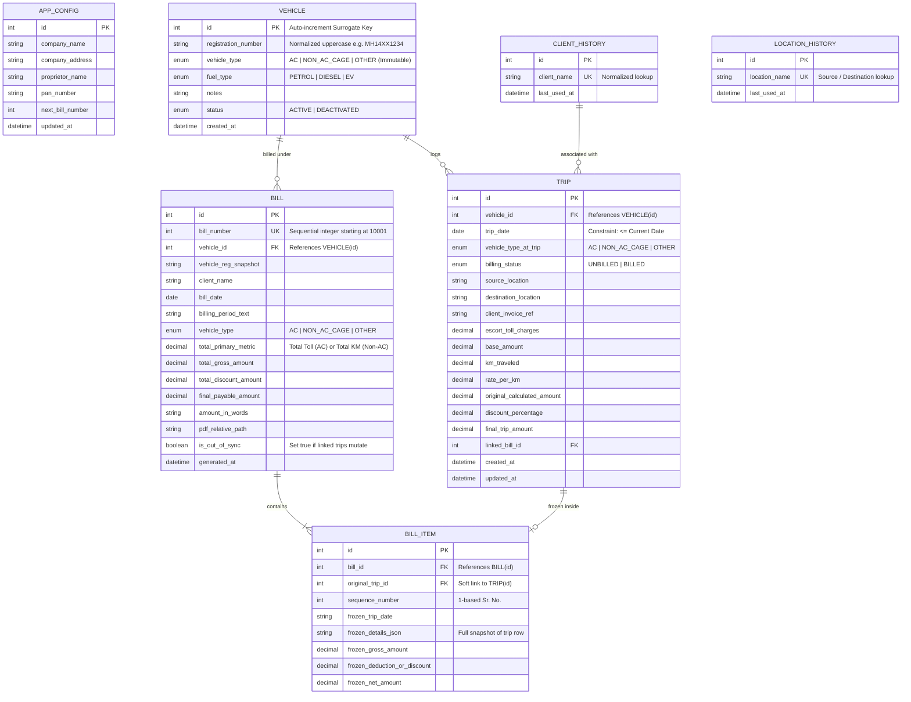

# Master Specification & Product Requirements Document (PRD)
## Thombre Transport — Fleet & Trip Management System (VRMS)

* **Document Version:** 1.0.0
* **Status:** APPROVED & LOCKED (Baseline Source of Truth)
* **Date:** 08-Nov-2026
* **Author / Architect:** System Design & Architecture Team
* **Primary Stakeholder / Actor:** Mr. Aditya Pokharkar
* **Target User:** Mr. Thombre (Proprietor, Thombre Transport)
* **Target Environment:** Stand-alone Android Mobile Application (Offline-first, Local SQLite/Room, Zero-Cloud Dependency)

---

## 1. System Overview & Business Context

### 1.1 Company & Operational Profile
* **Company Name:** Thombre Transport
* **Company Address:** Baur Gaon, Taluka - Maval, Dist - Pune, Maharashtra
* **Proprietor Name:** Mr. Thombre
* **Tax Identifier:** Permanent Account Number (PAN): `AIRPT2980M` (Editable via Application Profile Settings)
* **Core Business:** Road logistics and freight transportation operating primarily transport trucks (AC vehicles, Non-AC Cage vehicles, and Other specialized transport vehicles).

### 1.2 Objective & Architectural Scope
The application is a dedicated, stand-alone Android mobile system that serves as an **operational trip ledger, billing compilation engine, and PDF invoice generation tool**. All operational and financial records are stored locally on the handset using an embedded relational database (Jetpack Room / SQLite). No third-party servers, cloud APIs, or internet connectivity are required for normal operations.

---

## 2. Core Governance & Change Management Protocol

This document serves as the **absolute source of truth** for all architectural designs, database schemas, financial formulas, UI behaviors, and workflows. Moving forward, the system is strictly governed by the following compliance rules:

### 2.1 Zero-Unauthorized-Change Policy
Any requested code modification, business rule shift, or feature implementation that conflicts with or alters the rules defined in this document is **strictly prohibited** from being implemented directly. The assistant must immediately halt execution.

### 2.2 Explicit Conflict Flagging Protocol
If a requested change conflicts with this specification, the assistant must immediately halt and reply using the following mandatory format:

> ⚠️ **Core Requirement Mismatch Detected**
> * **Current Master Rule:** *[Quote the exact rule/text from this Master Specification MD File]*
> * **Your New Request:** *[Describe the new change requested]*
> 
> *Please review the mismatch above. Please provide your explicit final confirmation to override the Master Specification rule.*

### 2.3 Immutable Change Log Audit Trail
Only after explicit written confirmation from **Mr. Aditya Pokharkar** to override a master rule may this document be modified. Every modification must be permanently appended to the **Change Log Audit Table** in [Section 9](#9-change-log-audit-trail).

---

## 3. Module Specifications & Business Logic

### Module 1: Vehicle & Inventory Management

#### 1.1 Data Input & Validation Rules
* **Vehicle Registration Number:** 
  * Required string.
  * Real-time input filter: Automatically forces all characters to **UPPERCASE** and strips all whitespace and hyphens.
  * Validation: Evaluated against standard Indian RTO formats (`MH14XX1234`) and Bharat Series formats (`22BH1234AA`).
* **Vehicle Type:** Dropdown selector with options `[AC, Non-AC Cage, Other]`.
  * **Immutability Invariant:** Once a vehicle is created, its `Vehicle Type` is permanently locked and cannot be edited.
* **Fuel Type:** Dropdown selector with options `[Petrol, Diesel, EV]`. Default value: `Diesel`.
* **Other Details:** Optional free-text field for miscellaneous notes.

#### 1.2 Dashboard Presentation
* Responsive card-based layout.
* Each card prominently displays the Normalized Registration Number in large, bold typography.
* Secondary badges display the Vehicle Type and Fuel Type.
* Action triggers per card: "Log Trip" (Primary CTA) and "Generate Bill" (Secondary CTA).

#### 1.3 Deactivation, Deletion & Identity Isolation
* **Surrogate Key Architecture:** The vehicle table must use an auto-incrementing integer (`id`) as its primary key, **not** the registration string.
* **Soft Deactivation:** When an operator "deletes" an active vehicle, its status changes to `DEACTIVATED`. It is hidden from the main active fleet dashboard.
* **Active Plate Uniqueness:** An active vehicle cannot share a registration number with another *active* vehicle.
* **Duplicate Isolation Logic:** If Mr. Thombre adds a new vehicle whose registration string matches an existing `DEACTIVATED` vehicle, the system treats the new vehicle as a completely distinct entity with its own independent surrogate ID and isolated history.
* **Reactivation Rule:** A deactivated vehicle may be reactivated provided no other active vehicle currently holds that registration string.
* **Hard Deletion Restriction:** A vehicle may only be permanently deleted if it has **zero** linked trips and **zero** linked bills. If historical trips or bills exist, hard deletion is blocked to preserve accounting integrity.
* **UI Toggle:** A toggle switch in Fleet Settings / Dashboard labeled "View Deactivated Vehicles" enables viewing historical vehicle assets.

---

### Module 2: Dynamic Trip Management

Trips are logged against a selected vehicle. The input form dynamically adapts based on the vehicle’s immutable archetype.

#### 2.1 Common Rules & Constraints
* **Trip Date:** Date picker field. Must be $\le \text{Current Date}$. Future dates are strictly blocked. Back-dated trips are permitted without time limits.
* **Concurrent Trips:** Multiple distinct trips may be logged for the same vehicle on the same date.
* **Auto-Suggestion Scope:** All autocomplete/typeahead histories for `Source`, `Destination`, and `Client ("To")` are maintained **globally** across the entire application.
* **Client Association:** Client name is **not** assigned during trip logging; it is assigned exclusively during Bill Compilation.

#### 2.2 AC Vehicle Form Schema
1. **Trip Date:** Date picker ($\le \text{Current Date}$).
2. **Source:** Free-text input with global typeahead auto-suggestions.
3. **Destination:** Free-text input with global typeahead auto-suggestions.
4. **Invoice Number:** Alphanumeric client reference.
5. **Escort / Toll Charges:** Float/Numerical field ($\ge 0.00$) representing toll expenses incurred.
6. **Amount:** Float/Numerical field ($> 0.00$) representing the core charge to the client.
7. **UI Feature (Dynamic Words):** The system dynamically renders the "Amount in Words" in Indian numbering scale directly beneath the Amount input field.

#### 2.3 Non-AC Cage & "Other" Vehicle Form Schema
*"Other" vehicles completely adopt the Non-AC Cage workflow, input fields, calculation engine, and PDF template.*

1. **Trip Date:** Date picker ($\le \text{Current Date}$).
2. **KM (Kilometres):** Float/Numerical field ($> 0.00$) for distance traveled.
3. **Rate:** Float/Numerical field ($> 0.00$) charged per KM.
4. **Total Amount (Original):** Calculated field:
   $$\text{Original Total} = \text{KM} \times \text{Rate}$$
   *Locked from manual editing.*
5. **Discount (%):** Optional numerical field ($0.00 \le \text{Discount} < 100.00$). Applied strictly per trip.
6. **Net Calculated Amount:**
   $$\text{Net Amount} = \text{Original Total} - \left( \text{Original Total} \times \frac{\text{Discount}}{100} \right)$$
7. **UI Feature (Strike-through Display):** If a discount is applied, the original calculated amount is displayed with strike-through text (`~₹5000~`), and the net discounted amount is highlighted immediately underneath.
8. **UI Feature (Dynamic Words):** The system dynamically renders the "Total Amount in Words" in Indian numbering scale directly beneath the net amount field.

#### 2.4 Indian Number-to-Words Algorithm
All numerical conversions must strictly follow the **Indian Numbering System** (Tens, Hundreds, Thousands, Lakhs, Crores). Decimals represent Paise and must be formatted explicitly as `"and XX Paise Only"` without auto-rounding.

---

### Module 3: Bill Compilation & PDF Generation

Every vehicle card features a "Generate Bill" button, which opens the trip compilation interface restricted strictly to trips logged for that specific vehicle (multi-vehicle invoicing is out of scope).

#### 3.1 Trip Selection & Soft-Locking Guardrails
* The interface displays all unbilled trips for the selected vehicle.
* Trips previously included in a bill are labeled with a light bold badge: `"BILLED (Bill #XX)"`.
* **Soft Re-Billing Guard:** If an operator selects a trip marked `BILLED`, the app triggers a confirmation dialog:
  > *"This trip was already included in Bill #XX. Are you sure you want to bill it again?"*
* **Billed Trip Mutation Guard:** An operator is permitted to edit or delete a trip marked `BILLED`. However, clicking Edit or Delete triggers a strict warning popup:
  > *"This trip is linked to Bill #XX. Modifying it will cause your database to mismatch the saved PDF bill."*
* **Frozen Bill Snapshot & Out-of-Sync Flag:**
  * When a bill is finalized, its financial totals and line-item snapshots are frozen permanently in the database.
  * If a linked trip is later edited or deleted, the saved `Bill` record totals do **not** change (preserving historical match with the printed PDF).
  * The Bill’s status flag is immediately updated to `OUT_OF_SYNC_WITH_TRIPS`.
  * The Bill History screen displays a prominent yellow warning banner on that bill’s card:
    > *"Warning: The underlying trip data has changed since this invoice was generated."*

#### 3.2 Bill Compilation Header Data
* **Bill Number:** Monotonically increasing sequential integer.
  * **Starting Seed:** Starts at **`10001`** out of the box. The first bill generated is `#10001`, the second is `#10002`.
  * Sequence is global across the entire fleet.
  * Indefinite continuous sequence; does not reset with the financial year.
  * Manual override of bill numbers is strictly prohibited.
* **Bill Date:** Current date of invoice generation.
* **Vehicle Number:** Registration number of the selected vehicle.
* **Client ("To"):** Free-text company name with global typeahead auto-suggestions. Once the bill is finalized, selected trips are stamped with this client name.
* **Billing Period Label:**
  * Automatically derived from $\min(\text{Trip Date})$ and $\max(\text{Trip Date})$ of selected trips: `"Transport Bill From [Start Date] to [End Date]"`.
  * Editable: The operator can adjust the text string before generating the PDF.
  * **Single Trip Special Case:** If only one trip is selected, the label automatically formats as:
    `"Transport Bill For Date: [Trip Date]"`

#### 3.3 Unified PDF Header Architecture (Standard Indian Transport Format)
* **Header Name:** `"Thombre Transport"` (Prominent, Bold, Red font).
* **Company Address:** `"Baur Gaon, Taluka - Maval, Dist - Pune"` (Smaller font directly below header).
* **Proprietor Name:** `"Mr. Thombre"`.
* **PAN Number:** `"AIRPT2980M"`.

#### 3.4 PDF Table Layouts by Vehicle Type

##### Type 1: AC Vehicle Bill Layout (6 Columns)
$$\begin{array}{|c|c|l|c|r|r|}
\hline
\textbf{Sr. No.} & \textbf{Date} & \textbf{Trip} & \textbf{Invoice Number} & \textbf{Escort / Toll} & \textbf{Amount} \\
\hline
1 & \text{DD/MM/YYYY} & \text{[Source] TO [Destination]} & \text{INV-101} & \text{500.00} & \text{12000.00} \\
\hline
\end{array}$$

* **Summary Row Calculations:**
  1. `Total Escort/Toll Charges` = $\sum \text{Toll}$
  2. `Total Gross Amount` = $\sum \text{Amount}$
  3. `Final Payable Amount` = $\sum \text{Amount} + \sum \text{Toll}$  
     *(Tolls are driver out-of-pocket expenses fully reimbursed by the client).*

##### Type 2: Non-AC & Other Vehicle Bill Layout (7 Columns)
$$\begin{array}{|c|c|r|r|r|c|r|}
\hline
\textbf{Sr. No.} & \textbf{Date} & \textbf{KM} & \textbf{Rate} & \textbf{Original Amount} & \textbf{Discount \%} & \textbf{Net Amount} \\
\hline
1 & \text{DD/MM/YYYY} & 150.0 & 40.00 & 6000.00 & 10\% & 5400.00 \\
2 & \text{DD/MM/YYYY} & 80.0 & 40.00 & 3200.00 & 0\% & 3200.00 \\
\hline
\end{array}$$

* **Zero-Discount Formatting:** If a trip has $0\%$ discount, the column prints `0%`, and `Original Amount` equals `Net Amount`.
* **Summary Row Calculations:**
  1. `Total KM` = $\sum \text{KM}$
  2. `Total Original Amount` = $\sum \text{Original Amount}$
  3. `Total Discount Amount` = $\text{Total Original Amount} - \sum \text{Net Amount}$
  4. `Final Net Amount` = $\sum \text{Net Amount}$

---

### Module 4: Android OS Integration & Storage Architecture

#### 4.1 PDF Archival & Immediate Share Sheet
* **Immutable Snapshot:** Generated bills are rendered once and saved as static PDF files in app-sandboxed storage (`Context.getExternalFilesDir(Environment.DIRECTORY_DOCUMENTS)/bills/`).
* **Immediate UX Action:** The moment PDF generation completes, the app automatically triggers the **Android Native Share Sheet** via `androidx.core.content.FileProvider`.
* This enables Mr. Thombre to immediately open the document in a PDF viewer or send it via WhatsApp, Business WhatsApp, or Email.
* **Bill History View:** A dedicated screen allows viewing, opening, and re-sharing historical PDF files.

#### 4.2 Full Unified Backup & Restore (.vrms)
* **Scope:** Bundles both the local SQLite database file and the entire directory of saved PDF invoices.
* **Container Format:** Compressed `.zip` archive named `ThombreTransport_Backup_[TIMESTAMP].vrms`.
* **Storage Access Framework (SAF):**
  * **Export:** Uses `ActivityResultContracts.CreateDocument("application/zip")` allowing the user to pick any target directory (Internal Storage, SD Card, or Google Drive).
  * **Restore:** Uses `ActivityResultContracts.OpenDocument()` to select a `.vrms` archive, unpacks the database, verifies schema integrity, restores all PDF files, and refreshes app state.

---

## 4. Technical Architecture & Database Design

### 4.1 Technology Stack
* **Language:** Kotlin 2.0+
* **UI Toolkit:** Jetpack Compose with Material 3 (Custom Thombre Transport Red Palette)
* **Architecture:** MVVM + Clean Architecture with Unidirectional Data Flow (UDF)
* **Database ORM:** Jetpack Room (SQLite) with foreign key enforcement
* **PDF Rendering:** Native `android.graphics.pdf.PdfDocument` via virtual A4 Canvas ($595 \times 842$ pt)
* **File Sharing:** Android `FileProvider` (`content://` URI scheme)
* **Asynchronous I/O:** Kotlin Coroutines & StateFlow

### 4.2 Relational Database Schema

---

## 5. Screen Navigation & Application Flow

1. **Fleet Dashboard (`FleetDashboardScreen`):**
   * Grid of active vehicle cards (Registration, Type, Fuel).
   * Top bar: "View Deactivated Vehicles" toggle switch.
   * Floating Action Button (FAB): "Add Vehicle" with real-time Indian RTO regex validator.
   * Actions per card: "Log Trip" $\rightarrow$ opens Screen 2; "Generate Bill" $\rightarrow$ opens Screen 3.
2. **Trip Logger (`TripLoggerScreen`):**
   * Vehicle metadata banner.
   * Dynamic input form (AC schema vs. Non-AC/Other schema).
   * Real-time calculation of totals and Indian currency words.
   * Save action commits trip to Room database and updates autocomplete histories.
3. **Bill Compilation (`BillCompilationScreen`):**
   * Client name input with typeahead suggestions.
   * Editable billing period string (auto-derived from selected trips).
   * Trip list with selection checkboxes and "BILLED" warning badges.
   * "Generate & Share Bill" action executes atomic Room transaction, writes PDF, and triggers Native Share Sheet.
4. **Bill History (`BillHistoryScreen`):**
   * Chronological list of generated invoices.
   * Out-of-sync warning indicator (yellow banner) on affected invoices.
   * Direct actions: "Open PDF" and "Share".
5. **Settings & Maintenance (`SettingsScreen`):**
   * Thombre Transport profile editor (PAN field editable).
   * "Backup Data (.vrms)" button (launches SAF file creator).
   * "Restore Data" button (launches SAF file picker).

---

## 6. PDF Canvas Coordinate & Width Allocation (A4 Standard)

* **Physical Page Dimensions:** $595 \times 842$ points (A4 at 72 DPI).
* **Margins:** Left: $36\,\text{pt}$, Right: $36\,\text{pt}$, Top: $36\,\text{pt}$, Bottom: $36\,\text{pt}$.
* **Printable Width:** $523\,\text{pt}$.

### 6.1 AC Table Column Allocation ($523\,\text{pt}$)
| Column | Header | Width | Alignment |
| :---: | :--- | :---: | :---: |
| 1 | Sr. No. | $35\,\text{pt}$ | Center |
| 2 | Date | $65\,\text{pt}$ | Center |
| 3 | Trip (Source TO Destination) | $165\,\text{pt}$ | Left |
| 4 | Invoice Number | $85\,\text{pt}$ | Center |
| 5 | Escort / Toll | $75\,\text{pt}$ | Right |
| 6 | Amount | $98\,\text{pt}$ | Right |

### 6.2 Non-AC & Other Table Column Allocation ($523\,\text{pt}$)
| Column | Header | Width | Alignment |
| :---: | :--- | :---: | :---: |
| 1 | Sr. No. | $35\,\text{pt}$ | Center |
| 2 | Date | $65\,\text{pt}$ | Center |
| 3 | KM | $55\,\text{pt}$ | Right |
| 4 | Rate | $50\,\text{pt}$ | Right |
| 5 | Original Amount | $95\,\text{pt}$ | Right |
| 6 | Discount % | $65\,\text{pt}$ | Center |
| 7 | Net Amount | $158\,\text{pt}$ | Right |

---

## 7. Mathematical & Calculation Specifications

### 7.1 Non-AC Trip Level Calculation
$$\text{Original Amount} = \text{KM} \times \text{Rate}$$
$$\text{Discount Value} = \text{Original Amount} \times \left( \frac{\text{Discount \%}}{100} \right)$$
$$\text{Net Amount} = \text{Original Amount} - \text{Discount Value}$$

### 7.2 Non-AC Bill Summary Row
$$\text{Total KM} = \sum_{i=1}^{n} \text{KM}_i$$
$$\text{Total Original Amount} = \sum_{i=1}^{n} \text{Original Amount}_i$$
$$\text{Total Discount Amount} = \sum_{i=1}^{n} \text{Discount Value}_i$$
$$\text{Final Net Amount} = \text{Total Original Amount} - \text{Total Discount Amount}$$

### 7.3 AC Bill Summary Row
$$\text{Total Escort/Toll Charges} = \sum_{i=1}^{n} \text{Toll}_i$$
$$\text{Total Gross Amount} = \sum_{i=1}^{n} \text{Amount}_i$$
$$\text{Final Payable Amount} = \text{Total Gross Amount} + \text{Total Escort/Toll Charges}$$

---

## 8. Implementation Milestones & Roadmap

* **Milestone 1:** Project initialization, Gradle dependencies, Room Database entities, DAOs, migrations, and unit tests for Indian Number-to-Words.
* **Milestone 2:** Fleet Dashboard UI, custom uppercase RTO regex InputFilter, Add/Deactivate/Reactivate vehicle flows.
* **Milestone 3:** Dynamic Trip Logger with live amount-to-words conversion, strike-through discount formatting, and Room persistence.
* **Milestone 4:** Bill compilation workflow, atomic sequence counter (starting at `10001`), A4 PDF Canvas rendering engine, and `FileProvider` Share Sheet integration.
* **Milestone 5:** Out-of-sync mutation detection, Bill History screen, Unified `.vrms` ZIP backup and restore via Android SAF.

---

## 9. Change Log Audit Trail

This table permanently records all approved changes and overrides to the master specification. Any future modification must be authorized by **Mr. Aditya Pokharkar** following the Explicit Conflict Flagging Protocol.

| Timestamp | Actor | Original Requirement | Approved Change Description |
| :--- | :--- | :--- | :--- |
| 08-Nov-2026 19:45 | Mr. Aditya Pokharkar | Initial draft discussion | Formal ratification of Master Specification v1.0.0 baseline. |
